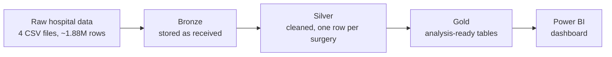

# Surgical Scheduling Variance Analysis

**How accurately does a hospital estimate how long each surgery will take, what do the misses cost, and which procedures should be fixed first?**

### [▶ Open the live dashboard](https://thrinesh13.github.io/Surgical-Scheduling-Variance-Analysis/)
*Runs in the browser. No sign-in or Power BI licence needed.*

<b>Watch the dashboard demo</b>

 

The operating room is one of the most expensive resources in a hospital, so how well it is scheduled has a direct effect on cost. Every surgery is booked with an estimated duration, but hospitals rarely go back and check whether those estimates were right. This project analyzes 48,118 real surgeries, benchmarks each case against its procedure's historical median, quantifies the variation in room hours and cost, and recommends which procedures to review first.

---

## Project Overview

| | |
|---|---|
| **Objective** | Identify and quantify cost opportunities in how a hospital uses its operating room capacity |
| **Domain** | Healthcare operations: hospital operating room (OR) scheduling |
| **Business problem** | Surgery time estimates are rarely checked. Wrong estimates cause overtime, delays and idle rooms |
| **Who it is for** | OR leadership, scheduling committees, hospital finance and capacity planning |
| **Data** | 48,118 real surgical cases (de-identified) across 418 procedure types, 5.75 years, UC Irvine Medical Center |
| **Tools** | Microsoft Fabric, PySpark, Spark SQL, Power BI, DAX |
| **Output** | Interactive Power BI dashboard, a prioritized review list, and data-driven recommendations for OR leadership |

## Key Findings

| **53.3%** | **7,539 hrs** | **$15.8M to $27.1M** | **133** |
|:---:|:---:|:---:|:---:|
| of surgeries missed their benchmark by more than 30 minutes | of room time variation a year | yearly cost exposure from that variation (scenario range) | procedures (of 418) drive 53.6% of the variation |

- **Misses go both ways.** 29.7% of surgeries ran more than 30 minutes long (19.2% by more than an hour), and 23.6% finished more than 30 minutes early.
- **Early finishes are a hidden cost.** They leave about **2,167 room hours a year** idle, roughly one fully staffed OR sitting empty every working day. Reports that focus only on overruns miss this.
- **A short review list does most of the work.** 133 of 418 procedures (about a third) account for more than half of all variation.

---

## Business Problem

Every surgery is booked with an estimate of how long it will take. That estimate decides which room is used, when it starts, which staff are held, and how many cases fit after it.

- If a case **runs long**, the hospital pays overtime and every case behind it is delayed.
- If a case **finishes early**, a fully staffed room sits empty.

On a single case, a miss of 30 minutes to an hour doesn't look like much. The room gets used, the schedule adjusts, and the day moves on. Across thousands of surgeries a year, those misses add up to thousands of room hours and millions of dollars.

The root cause is a missing feedback loop. Hospitals rarely go back and check estimates against actual times, so no one knows which procedures are mis-estimated or what the misses cost. The cost stays hidden in day-to-day operations, and a problem that looks like "we need more rooms" may really be a booking-accuracy problem.

**The goal:** benchmark every surgery against its procedure's typical duration, measure how far and how often cases miss, quantify the gap as a cost range, and prioritize the procedures that should be reviewed first.

## Business Questions

| # | Question | Answer |
|:---:|---|---|
| 1 | **Measure:** How often do surgeries run more than 30 minutes longer or shorter than normal for that procedure? | **53.3%** of cases |
| 2 | **Direction:** Do the misses lean late, early, or both? | Both. Late cases are more common (1.26 to 1) and larger (107.8 vs. 65.9 min), but early finishes still leave **2,167 room hours a year** idle |
| 3 | **Size:** What is the variation worth each year? | **7,539 room hours**, a scenario range of **$15.8M to $27.1M** |
| 4 | **Prioritize:** Which procedures should the scheduling committee review first? | **133 of 418** procedures drive 53.6% of the variation |

## Stakeholders

| Stakeholder | Decisions Supported |
|---|---|
| OR and surgical leadership | Which procedures go on the review agenda, and in what order |
| Scheduling and block-time committees | How much time to book per procedure |
| Finance and capacity planning | How much capacity is really needed, and what scheduling variation costs each year |

---

## Recommendations

1. **Start with the 133 high-impact procedures.** They cover over half the variation.
2. **Set booking times per procedure on purpose.** Adding padding to everything reduces overruns but increases idle time.
3. **Clean up procedure names first.** 207 procedure names cover more than one type of operation, which makes them look less predictable than they are. This is the cheapest fix.
4. **Add a percentage-based tolerance** next to the 30 minute rule. A fixed 30 minutes is a large miss on a short procedure but a small one on a five-hour procedure, so judging each case relative to its benchmark gives a fairer view of long surgeries.
5. **Start recording the booked duration.** This is the one data change that would separate a bad estimate from normal surgical variation.

> [!NOTE]
> The dollar figures are a **scenario range, not a confirmed loss**. The variation is quantified at a lower estimate of **$35** and an upper estimate of **$60** per OR minute. Some variation is simply the nature of surgery, and not every OR cost changes when time is saved, so treat the range as an upper bound on what better scheduling could recover.

**Beyond the OR.** The method applies wherever a cost or utilization gap needs sizing: benchmark against a peer group, account for case mix and low volume, put the gap in dollars, and rank where the opportunity concentrates.

---

## Solution Architecture

**Why Microsoft Fabric:** it supports end-to-end analytics and reporting in one platform. Loading, PySpark cleaning, the lakehouse layers and the Power BI report all live in the same workspace, and the full process runs as one Fabric pipeline in about 7 minutes with the same result every run.

| Step | What happened | Notebook |
|---|---|---|
| **1. Load** | Loaded four raw files into a Microsoft Fabric lakehouse and verified row counts matched the source | [`01_bronze_ingest`](notebooks/01_bronze_ingest.ipynb) |
| **2. Clean** | Removed 1,366 duplicate rows, fixed 13 broken timestamps, and flagged every value that was changed | [`02_silver_patient_information`](notebooks/02_silver_patient_information.ipynb) |
| **3. Model** | Built a benchmark for each procedure (its typical duration from at least 30 past cases) and compared every surgery against it | [`03_gold`](notebooks/03_gold.ipynb) |
| **4. Report** | Built a Power BI semantic model with DAX measures for duration error, timing and cost exposure, plus an interactive dashboard | [`powerbi/`](powerbi/) |

<b>Methodology and Data Quality</b>

 

**Benchmark choice.** Each procedure's benchmark is its historical **median** duration, not the average. Surgery times are skewed by a few very long cases, and an average would make ordinary cases look early.

**Minimum volume.** A procedure needs 30 qualifying cases to get a benchmark. This was tested: the lowest-volume quartile misses the 30 minute band 61.5% of the time versus 55.2% for the highest, so a higher floor would lose coverage for little gain.

**Typical miss vs. average miss.** The average miss is 54.1 minutes, but the typical (median) miss is 33.0 minutes. A small number of very large misses pulls the average up.

**Overruns vs. early finishes.** Late cases are slightly more common (1.26 to 1) and much larger when they happen (107.8 min vs. 65.9 min on average). This holds for 388 of 418 procedures.

**Percentages.** Cohort percentages are calculated across all 48,118 cases, not averaged from per-procedure rates, so large procedures carry their true weight (53.28% vs. 58.4% unweighted).

**Data cleaning checkpoints**

| Checkpoint | Rows |
|---|---:|
| Raw patient records | 65,728 |
| After removing exact duplicates | 64,362 |
| One row per surgery | 64,354 |
| Final cleaned table | 64,353 |
| With a usable OR duration | 57,861 |
| **Cases in scope** | **48,118** |

Cleaning barely changed the headline averages (54.0 to 54.1 min), but it did change the totals, which the cost figures rely on.

**Pipeline and model screenshots**

---

## Limitations

- **No booked times in the source data.** The benchmark is each procedure's historical median, so a poor estimate and naturally variable surgery look the same.
- **Cost rates are assumptions**, not any hospital's actual costs.
- **Rare procedures are excluded.** 16.8% of cases with a usable duration fall outside the analysis, mostly due to low volume.
- **Dates are shifted for privacy**, so seasonal and weekday patterns cannot be studied.
- **Duration means time in the room**, from entry to exit, not surgery time alone.

## Data Source

[MOVER](https://doi.org/10.24432/C5VS5G), a de-identified surgical dataset released by UC Irvine Medical Center. Access requires a data use agreement, so **no patient-level data is stored in this repository**.

## Repository Structure

| Folder / file | Contents |
|---|---|
| [`dashboard/`](dashboard/) | Static web version of the dashboard |
| [`notebooks/`](notebooks/) | PySpark notebooks for each pipeline step |
| [`powerbi/`](powerbi/) | Power BI project (data model and report) |
| [`docs/DATA_QUALITY.md`](docs/DATA_QUALITY.md) | Data profiling, cleaning and validation rules |
| [`docs/DATA_LINEAGE.md`](docs/DATA_LINEAGE.md) | How each field flows from source to dashboard |
| [`docs/DASHBOARD_GUIDE.md`](docs/DASHBOARD_GUIDE.md) | How to read and filter the dashboard |

> The web dashboard is a fixed snapshot built so it can be shared without a Power BI licence. It does not refresh from Fabric.
