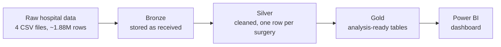

# Surgical Scheduling Variance Analysis

**Operating room scheduling analysis of 48,118 surgeries: how far case times miss their benchmark, what the variation costs, and which procedures to review first.**

### [▶ Open the live dashboard](https://thrinesh13.github.io/Surgical-Scheduling-Variance-Analysis/)
*Runs in the browser. No sign-in or Power BI licence needed.*

<b>Watch the dashboard demo</b>

 

## Overview

Every surgery is booked with an estimated duration. A case that runs long causes overtime and delays the cases behind it, and a case that finishes early leaves a staffed room idle. Hospitals rarely check estimates against actual times, so the cost of these misses stays hidden.

This project benchmarks each surgery against its procedure's historical median, measures how often and how far cases miss, sizes the variation in room hours and dollars, and ranks the procedures to review first.

| | |
|---|---|
| **Domain** | Healthcare operations: operating room (OR) scheduling |
| **Data** | 48,118 de-identified surgical cases, 418 procedure types, 5.75 years, UC Irvine Medical Center |
| **Tools** | Microsoft Fabric, PySpark, Spark SQL, Power BI, DAX |
| **Audience** | OR leadership, scheduling committees, finance and capacity planning |
| **Output** | Interactive Power BI dashboard, prioritized procedure review list, recommendations |

---

## Approach

1. **Cleaned the data with every change traceable.** Removed 1,366 duplicate rows and repaired 13 broken timestamps, checked against the anesthesia start time (median gap of 0 minutes from OR start). Repaired values are flagged, and one record that could not be repaired with confidence was excluded.
2. **Used the median as the benchmark, not the average.** A few very long cases skew surgery times, so an average would make ordinary cases look early.
3. **Required at least 30 cases per procedure, after testing it.** The lowest-volume quartile missed the 30-minute band 61.5% of the time versus 55.2% for the highest, so a higher floor would lose procedures for little gain.
4. **Measured misses in both directions.** Tracking only overruns would hide the cost of idle rooms.
5. **Weighted results by case, not by procedure.** Averaging per-procedure rates would overstate the miss rate (58.4% instead of 53.3%).
6. **Sized the cost as a range** of $35 to $60 per OR minute, since real OR costs differ by hospital.

**Data in scope**

| Step | Rows |
|---|---:|
| Raw patient records | 65,728 |
| Cleaned table, one row per surgery | 64,353 |
| With a usable OR duration | 57,861 |
| **Analysis cohort** (10 to 720 minutes, procedure with 30+ cases) | **48,118** |

---

## Key Findings

### 1. More than half of surgeries miss their benchmark by over 30 minutes

**53.3%** of cases (25,637 of 48,118) finished more than 30 minutes away from their procedure's benchmark.

- **What the chart shows:** the timing bar splits all cases into 23.6% early by more than 30 minutes, 46.7% within 30 minutes, 10.6% late by 30 to 60 minutes and 19.2% late by more than 60 minutes.
- **Business impact:** with case times this far from the procedure norm, daily OR schedules regularly run over or leave gaps, and the problem is not limited to a few outlier cases.

### 2. Overruns are more common and larger, but early finishes also cost time

Late cases outnumber early ones 1.26 to 1. Late cases also miss by more (107.8 vs. 65.9 minutes on average), a pattern that holds for 388 of 418 procedures. Early finishes still leave about **2,167 room hours a year** idle, roughly one fully staffed OR sitting empty every working day.

- **Business impact:** a blanket buffer on every booking would reduce overruns but add to the 2,167 idle hours, so booking times need to be set per procedure.

### 3. The variation adds up to 7,539 room hours a year

Room time variation totals **7,539 hours a year**, a scenario range of **$15.8M to $27.1M**. The typical (median) miss is 33.0 minutes, and a few very large misses pull the average to 54.1.

- **Business impact:** part of what looks like a shortage of OR capacity is scheduling variation, so some of this time can be recovered before adding OR time or staff.

### 4. 133 procedures drive more than half of the variation

**133 of 418 procedures** (about a third) account for **53.6%** of yearly room time variation.

- **What the chart shows:** the scatter plot places each procedure by yearly variation (x-axis, log scale) and share of cases outside 30 minutes (y-axis). The orange cluster in the upper right is the 133 procedures with high cost exposure and low predictability. The table ranks procedures by miss rate, led by maxillectomy (92.3%) and exploratory laparoscopy (90.4%).
- **Business impact:** the scheduling committee can address 53.6% of the variation by reviewing a third of procedures instead of all 418.

### 5. Procedure names hide part of the pattern

**207 procedure names** combine more than one type of operation under a single label, which makes those procedures look less predictable than they are.

- **Business impact:** part of the measured variation comes from labeling, and splitting these names is the lowest-cost way to make benchmarks more accurate.

> [!NOTE]
> The dollar figures are a **scenario range, not a confirmed loss**. Some variation is the nature of surgery, and not every OR cost changes when time is saved, so treat the range as an upper bound on what better scheduling could recover.

---

## Recommendations

1. **Start with the 133 high-impact procedures**, in the order of the dashboard's review list.
2. **Set booking times per procedure** from each procedure's own benchmark, not one standard buffer.
3. **Split the 207 compound procedure names** and rebuild their benchmarks.
4. **Add a percentage-based tolerance** alongside the 30-minute rule. Thirty minutes is a large miss on a one-hour procedure but a small one on a five-hour procedure.
5. **Start recording the booked duration.** This is the one data change that would separate a poor estimate from normal surgical variation.

## Limitations

- **No booked times in the source data.** The benchmark is each procedure's historical median, so a poor estimate and naturally variable surgery look the same.
- **Cost rates are assumptions**, not any hospital's actual costs.
- **Rare procedures are excluded.** 16.8% of cases with a usable duration fall outside the cohort, mostly due to low volume.
- **Dates are shifted for privacy**, so seasonal and weekday patterns cannot be studied.
- **Duration is time in the room**, from entry to exit, not surgery time alone.

---

## Data Pipeline

Built in Microsoft Fabric as PySpark notebooks ([load](notebooks/01_bronze_ingest.ipynb), [clean](notebooks/02_silver_patient_information.ipynb), [model](notebooks/03_gold.ipynb)) and a [Power BI semantic model](powerbi/) with DAX measures for timing, variation and cost. The full pipeline runs in about 7 minutes.

<b>Pipeline and model screenshots</b>

 

## Data Source

[MOVER](https://doi.org/10.24432/C5VS5G), a de-identified surgical dataset released by UC Irvine Medical Center. Access requires a data use agreement, so **no patient-level data is stored in this repository**.

## Repository Structure

| Folder / file | Contents |
|---|---|
| [`notebooks/`](notebooks/) | PySpark notebooks for each pipeline step |
| [`powerbi/`](powerbi/) | Power BI project (semantic model and report) |
| [`dashboard/`](dashboard/), [`index.html`](index.html) | Static web version of the dashboard |
| [`dashboard-data/`](dashboard-data/) | Data exported from the dashboard visuals |
| [`assets/`](assets/) | Dashboard and pipeline screenshots |
| [`docs/DATA_QUALITY.md`](docs/DATA_QUALITY.md) | Data profiling, cleaning and validation rules |
| [`docs/DATA_LINEAGE.md`](docs/DATA_LINEAGE.md) | How each field flows from source to dashboard |
| [`docs/DASHBOARD_GUIDE.md`](docs/DASHBOARD_GUIDE.md) | How to read and filter the dashboard |

> The web dashboard is a fixed snapshot so it can be shared without a Power BI licence. It does not refresh from Fabric.

---

**Thrinesh Vuribindi**, Data Analyst · 
